# Department Management System (University Student Management System)

## 1. Project Title

**Department & University Student Management System (USMS)**

## 2. Project Overview

The Department Management System is a full-stack web application designed to streamline academic and administrative operations within an educational institution.

The system provides centralized management of users, departments, courses, student enrollments, grades, and attendance. It also includes an administrative dashboard for monitoring system activity through API logs and dashboard statistics.

The application uses a React-based frontend, an Express.js backend, and a PostgreSQL relational database.

## 3. Assignment Information

- **Organization:** GudSky Research Foundation
- **Assignment Title:** Department Management System with Admin Dashboard
- **Project Scope:** Full-stack application development, authentication and authorization, database management, security implementation, API development, testing, and deployment.

## 4. Key Features

- **Role-Based Access Control (RBAC):** Role-specific access for Admins, Teachers, and Students.
- **Secure Authentication:** JWT-based access and refresh token authentication with password hashing.
- **Department Management:** View, create, and update academic departments.
- **Course Management:** Manage courses, course information, and instructor assignments.
- **Student Enrollment:** Handle student course enrollments and enrollment status.
- **Grade Management:** Allow authorized teachers to manage student grades.
- **Attendance Tracking:** Display and track student attendance information.
- **Admin Dashboard:** Monitor users, system statistics, and API activity logs.
- **API Logging:** Record API request metadata, response status codes, and response times.
- **Security Middleware:** Implement security headers, CORS configuration, rate limiting, and input validation.

## 5. Technology Stack

| Layer | Technologies |
|---|---|
| Frontend | React.js, React Router, CSS3, JavaScript |
| Backend | Node.js, Express.js |
| Authentication | JSON Web Token (JWT), bcrypt |
| Database | PostgreSQL |
| API Testing | Postman |
| Development Tools | Git, GitHub, VS Code |

## 6. System Architecture

The application follows a decoupled client-server architecture.

The React single-page application communicates with the Express.js backend through RESTful APIs using JSON data.

The backend handles authentication, authorization, business logic, request validation, and database operations. PostgreSQL stores application data using relational tables and foreign key constraints.

**Application Flow:**

React Frontend → Express.js REST API → PostgreSQL Database

## 7. User Roles

### Admin
- Access the administrative dashboard.
- Monitor registered users.
- Manage departments and courses.
- View API activity logs.
- Access dashboard statistics.

### Teacher
- View assigned courses.
- View enrolled students.
- Manage student grades.
- View and track attendance information.

### Student
- View personal profile.
- Browse available courses.
- View enrolled courses.
- Check grades and attendance.
- View enrollment status.

## 8. Project Folder Structure

```text
department-management-system/
│
├── backend/
│   ├── config/
│   ├── controllers/
│   ├── middleware/
│   ├── routes/
│   ├── services/
│   ├── migrations/
│   ├── server.js
│   ├── package.json
│   ├── .env.example
│   └── README.md
│
├── frontend/
│   ├── public/
│   ├── src/
│   │   ├── assets/
│   │   ├── components/
│   │   ├── context/
│   │   ├── hooks/
│   │   ├── pages/
│   │   ├── routes/
│   │   ├── services/
│   │   ├── utils/
│   │   ├── App.jsx
│   │   └── main.jsx
│   ├── package.json
│   └── README.md
│
├── .gitignore
└── README.md
```
## 9. Database Overview

The project uses a PostgreSQL relational database consisting of five core tables connected through primary key and foreign key relationships.

### Database Tables

1. **users:** Stores user accounts, hashed passwords, profile information, roles (`Admin`, `Teacher`, `Student`), and account status.

2. **departments:** Stores academic department information, including department ID, name, unique department code, and related institutional details.

3. **courses:** Stores course information, including course name, course code, department, assigned instructor, credits, semester, and maximum enrollment capacity.

4. **enrollments:** Connects students with courses and maintains enrollment dates, grades, attendance percentages, and enrollment status.

5. **api_logs:** Records API activity, including HTTP methods, endpoints, user references, request and response data, status codes, response times, and timestamps.

## 10. Installation & Setup

Follow these instructions to run the project locally.

### Prerequisites

- Node.js (version required by the project)
- npm
- PostgreSQL
- Git

### Step 1: Clone the Repository

```bash
git clone YOUR_GITHUB_REPOSITORY_URL
cd department-management-system
```

### Backend Setup

```bash
cd backend
npm install
```

Configure your `.env` file using the provided `.env.example` file.

Start the backend development server:

```bash
npm run dev
```

### Frontend Setup

Open a separate terminal:

```bash
cd frontend
npm install
```

Configure the frontend environment file with the backend API base URL.

Start the frontend development server:

```bash
npm run dev
```

### Frontend Production Build

```bash
npm run build
```

### Preview Production Build

```bash
npm run preview
```

## 11. Environment Variables
Create a `.env` file inside the `backend` directory and configure your local environment credentials:
```env
PORT=5000
DB_HOST=localhost
DB_USER=postgres
DB_PASSWORD=your_postgres_password
DB_NAME=university_db
DB_PORT=5432
JWT_SECRET=your_super_secret_jwt_key
JWT_REFRESH_SECRET=your_super_secret_refresh_key
```

## 12. API Documentation

The backend provides 17 core RESTful API endpoints to support authentication, department management, course management, student enrollments, user profile access, and administrative monitoring.

All protected endpoints require a valid JWT access token in the Authorization header, unless otherwise specified.

### 12.1 Authentication Module

| No. | Method | Endpoint | Description |
|---|---|---|---|
| 1 | POST | `/api/auth/register` | Register a new user account. |
| 2 | POST | `/api/auth/login` | Authenticate a user and generate access and refresh tokens. |
| 3 | POST | `/api/auth/refresh-token` | Generate a new access token using a valid refresh token. |

### 12.2 Department Management Module

| No. | Method | Endpoint | Description |
|---|---|---|---|
| 4 | GET | `/api/departments` | Retrieve the list of departments. |
| 5 | GET | `/api/departments/:dept_id` | Retrieve details of a specific department. |
| 6 | POST | `/api/departments` | Create a new department. |
| 7 | PUT | `/api/departments/:dept_id` | Update an existing department. |

### 12.3 Course Management Module

| No. | Method | Endpoint | Description |
|---|---|---|---|
| 8 | GET | `/api/courses` | Retrieve the available courses. |
| 9 | POST | `/api/courses` | Create a new course. |

### 12.4 Student Enrollment Module

| No. | Method | Endpoint | Description |
|---|---|---|---|
| 10 | POST | `/api/enrollments` | Enroll a student in a course. |
| 11 | GET | `/api/enrollments/student/:student_id` | Retrieve enrollments for a specific student. |
| 12 | PUT | `/api/enrollments/:enrollment_id/grade` | Update the grade of a student enrollment. |
| 13 | DELETE | `/api/enrollments/:enrollment_id` | Delete a specific enrollment. |

### 12.5 Admin & System Monitoring Module

| No. | Method | Endpoint | Description |
|---|---|---|---|
| 14 | GET | `/api/admin/api-logs` | Retrieve API activity logs. |
| 15 | GET | `/api/admin/api-logs/:log_id` | Retrieve details of a specific API log. |
| 16 | GET | `/api/admin/dashboard-stats` | Retrieve administrative dashboard statistics. |

### 12.6 User Management Module

| No. | Method | Endpoint | Description |
|---|---|---|---|
| 17 | GET | `/api/users/:user_id` | Retrieve the profile information of a specific user. |

### Authentication Header

Protected endpoints use JWT access-token authentication.

```http
Authorization: Bearer <access_token>
```

### API Response Format

The API returns JSON responses containing relevant data or error information.

**Note:** Actual HTTP status codes and response structures depend on the endpoint implementation.

### Additional Endpoints

Any additional endpoints implemented beyond the 17 assignment-required APIs should be documented separately and identified as additional project functionality.

## 13. Security Implementation

The application implements multiple security mechanisms to protect user accounts, API endpoints, and database operations.

### 13.1 Password Security
- User passwords are hashed using bcrypt before being stored in the database.
- Plain-text passwords are never stored in the database.

### 13.2 JWT Authentication
- Access tokens are used to authenticate protected API requests.
- Refresh tokens are used to obtain new access tokens.
- Token signature and validity are verified by authentication middleware.

### 13.3 Role-Based Access Control (RBAC)
- The application supports three roles: Admin, Teacher, and Student.
- Role-based middleware restricts access to protected routes and operations.
- Users can access resources according to their assigned permissions.

### 13.4 HTTP Security Headers
- Helmet middleware is used to configure HTTP security headers.

### 13.5 Cross-Origin Resource Sharing (CORS)
- CORS middleware controls cross-origin requests from authorized frontend origins.

### 13.6 Rate Limiting
- Express Rate Limit middleware is used to restrict excessive API requests and reduce abuse.

### 13.7 Input Validation and SQL Injection Protection
- API inputs are validated before processing.
- Parameterized SQL queries are used for database operations to reduce SQL injection risks.

### 13.8 API Logging and Monitoring
- API requests are recorded with relevant metadata, response status codes, and execution times.
- Sensitive information is redacted from logged request and response data.
- Administrative access is required to view protected API logs.

### 13.9 Environment Configuration
- Database credentials and authentication secrets are configured through environment variables.
- Sensitive configuration files are excluded from version control.


## 14. Testing

The application was tested across backend APIs, frontend functionality, authentication, authorization, and database operations to verify system reliability and correctness.

### 14.1 Authentication Testing
- User registration with valid and invalid inputs.
- Login with valid and incorrect credentials.
- Duplicate email registration validation.
- Access token verification.
- Refresh token functionality.
- Invalid, missing, and expired token handling.

### 14.2 API Testing
- Tested the assignment-required REST API endpoints using Postman.
- Verified successful API responses.
- Tested invalid request parameters and payloads.
- Verified appropriate HTTP status codes and error responses.

### 14.3 Role-Based Access Control Testing
- Verified Admin, Teacher, and Student permissions.
- Tested unauthorized access to protected routes.
- Verified student-specific data access restrictions.
- Tested teacher access to assigned course and enrollment data.
- Verified administrative endpoint protection.

### 14.4 Database Testing
- Verified database connectivity.
- Tested CRUD operations supported by the application.
- Checked primary key and foreign key relationships.
- Verified unique constraints and duplicate record handling.
- Tested enrollment capacity validation.

### 14.5 Enrollment and Academic Testing
- Tested student enrollment creation.
- Verified duplicate enrollment prevention.
- Tested enrollment retrieval.
- Tested grade update functionality.
- Tested enrollment deletion.
- Verified attendance information.

### 14.6 Frontend Testing
- Tested Admin, Teacher, and Student dashboards.
- Verified navigation and protected routes.
- Tested forms, input validation, and API integration.
- Checked loading, success, error, and empty states.
- Verified responsive layouts.

### 14.7 API Logging Testing
- Verified API request logging.
- Checked HTTP methods, endpoints, status codes, and response times.
- Tested administrative log retrieval and pagination.
- Verified log retention and cleanup functionality.

### 14.8 Testing Tools

- **Postman:** REST API and authentication testing.
- **PostgreSQL:** Database query and integrity verification.
- **Browser Developer Tools:** Frontend functionality and console inspection.


## 15. Screenshots

This section showcases the application's frontend interface and backend API testing results.

### 15.1 Authentication

**Login Page**

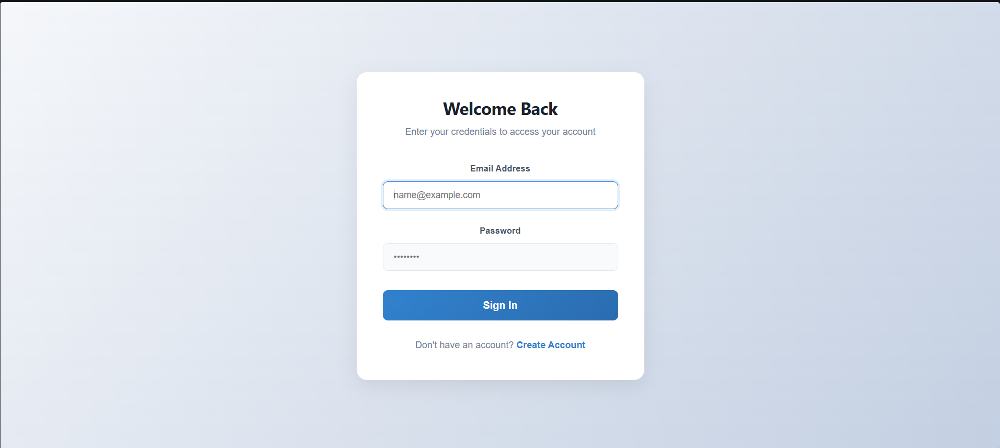

**Registration Page**

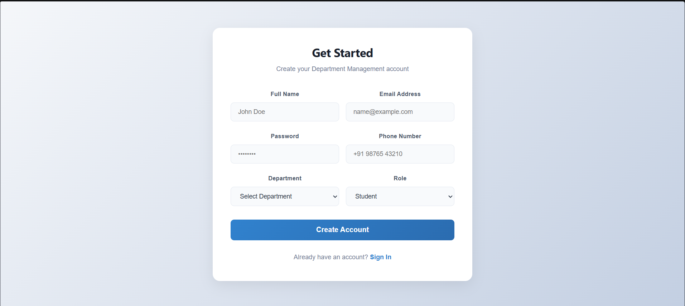

### 15.2 Admin Dashboard

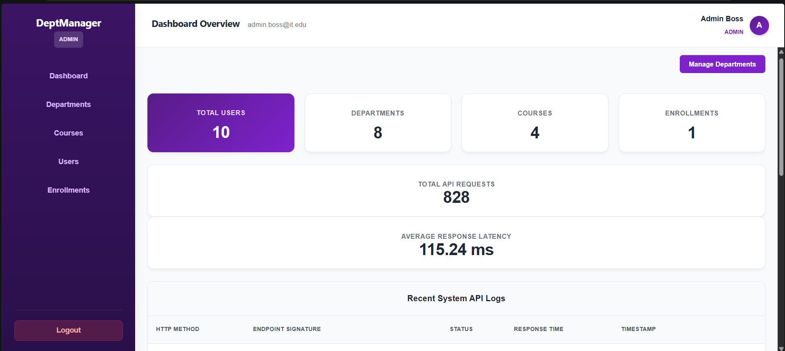
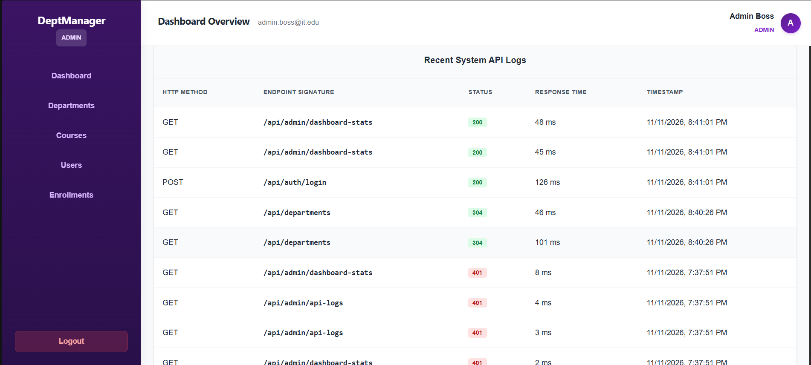

### 15.3 Department Management

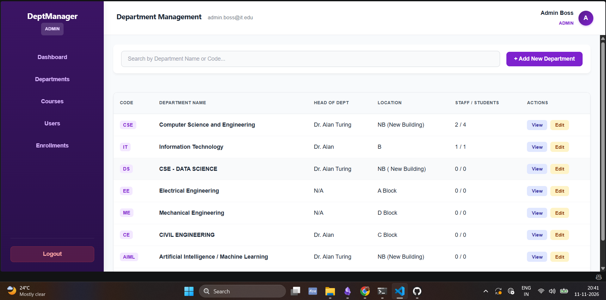

### 15.4 Course Management

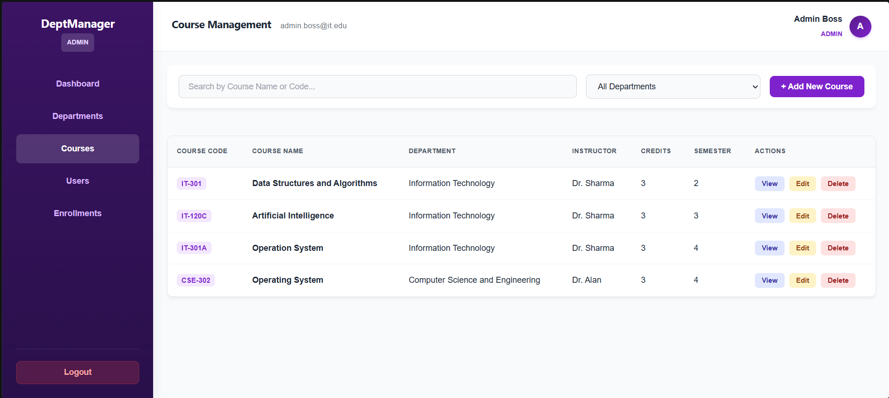

### 15.5 User Management

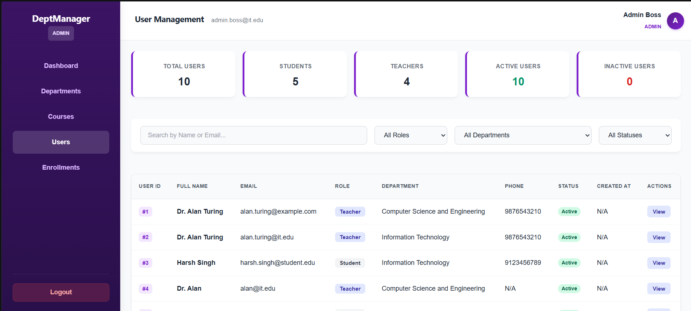

### 15.6 Enrollment Management

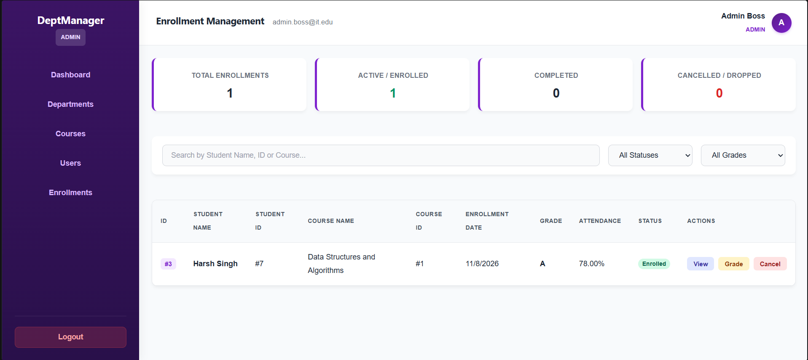

### 15.7 Teacher Dashboard

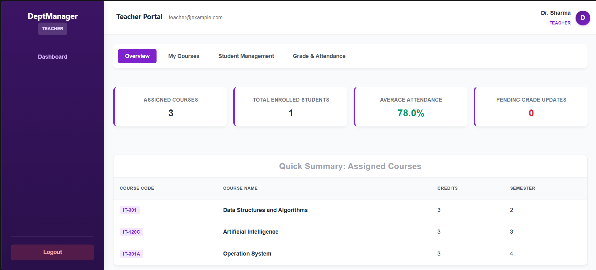

### 15.8 Student Dashboard

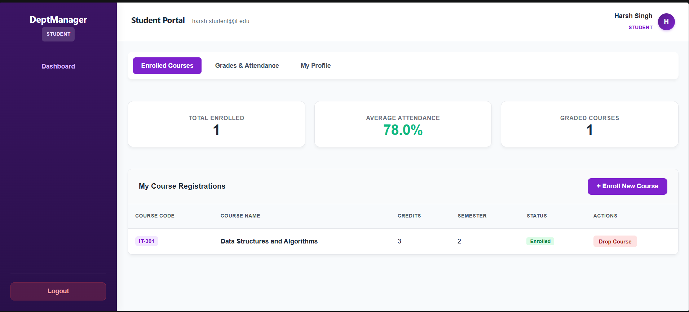

### 15.9 Attendance Management

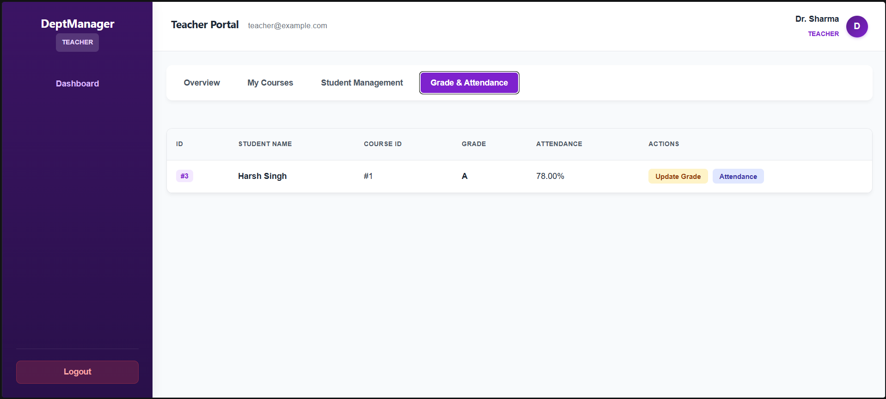


## 16. Deployment URLs

The application deployment links will be updated after successful production deployment.

- **Frontend Application:** Pending Deployment
- **Backend API Service:** Pending Deployment
- **Database:** PostgreSQL

### Local Development URLs

- **Frontend:** `http://localhost:5173`
- **Backend API:** `http://localhost:5000/api`


## 17. Author Information

**Developed By:** Harsh Shubham Singh

**Project:** Department & University Student Management System (USMS)

**Organization:** GudSky Research Foundation

**Institution:** Asansol Engineering College

**Technology Focus:** Full-Stack Web Development, REST API Development, Database Management, and Authentication & Authorization.

### Connect

- **GitHub:** [Add Your GitHub Profile URL](https://github.com/harshshubham987-svg)
- **Project Repository:** [Add Your Repository URL](https://github.com/harshshubham987-svg/Department-Management-System)

---

**Thank you for reviewing this project!**
